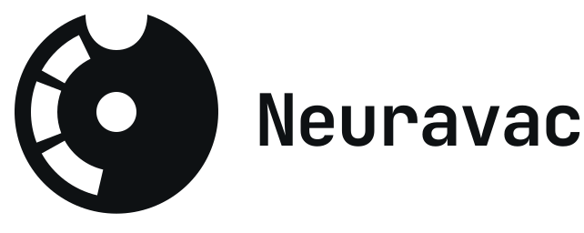
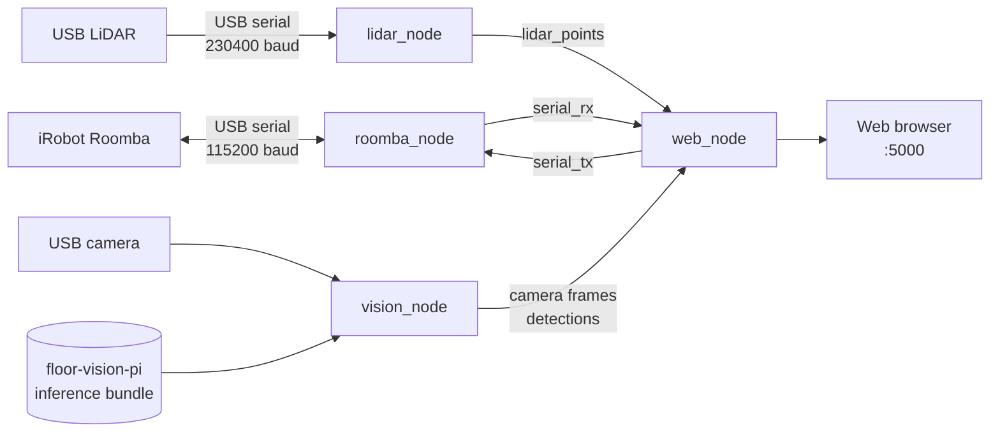

# NeuraVac

<p align="center" style="background-color: #ffffff; padding: 20px; border-radius: 6px;">
  
</p>

NeuraVac is a ROS 2 robot platform built around an iRobot Roomba. It combines
direct Roomba control, USB LiDAR, camera-based floor-object detection, and a
browser dashboard into one ROS 2 workspace.

The project is designed so that hardware drivers publish and consume ROS
topics instead of depending on each other directly:

- The Roomba node owns the Roomba's Open Interface serial connection.
- The LiDAR node parses scan packets and publishes individual range points.
- The vision node publishes camera frames and object detections.
- The web node bridges ROS topics to a Flask dashboard for monitoring and
  manual control.
- The interfaces package contains the messages shared by those nodes.

## System overview



The hardware nodes can run independently. ROS 2 provides the transport and
the dashboard subscribes to the topics it needs. Vision detections contain
advisory actions such as `clean`, `avoid`, and `avoid_and_review`; the vision
node does **not** drive the Roomba.

## ROS 2 packages

| Package | Type | Responsibility |
| --- | --- | --- |
| [`roomba`](src/roomba) | `ament_python` | Opens the Roomba serial port, sends Open Interface commands, and publishes/receives raw serial bytes. |
| [`lidar`](src/lidar) | `ament_python` | Reads the LiDAR serial stream, validates packets, decodes angle/distance/intensity, and publishes points. |
| [`roomba_interfaces`](src/roomba_interfaces) | `ament_cmake` | Builds the custom ROS 2 messages shared by the nodes. |
| [`vision`](src/vision) | `ament_python` | Captures camera frames, runs the deployed floor-vision model, and publishes detections. |
| [`web`](src/web) | `ament_python` | Runs the Flask dashboard and bridges browser actions and telemetry to ROS 2. |

### Interfaces and topics

#### Roomba serial bridge

| Topic | Type | Direction | Purpose |
| --- | --- | --- | --- |
| `serial_rx` | `roomba_interfaces/msg/SerialData` | Roomba -> ROS | Raw bytes received from the Roomba. |
| `serial_tx` | `roomba_interfaces/msg/SerialData` | ROS -> Roomba | Raw bytes sent to the Roomba. |

`SerialData` contains a `uint8[] data` field. The Roomba node starts the
robot in safe mode and uses 115200 baud by default.

#### LiDAR

| Topic | Type | Purpose |
| --- | --- | --- |
| `lidar_points` | `roomba_interfaces/msg/LidarPoint` | Decoded points containing `angle_deg`, `distance_mm`, and `intensity`. |

The LiDAR node expects the D6 packet format described in the source and uses
230400 baud by default.

#### Vision

| Topic | Type | Purpose |
| --- | --- | --- |
| `camera/image/compressed` | `sensor_msgs/msg/CompressedImage` | JPEG camera frames. |
| `camera/image_annotated/compressed` | `sensor_msgs/msg/CompressedImage` | JPEG frames with model annotations. |
| `camera/detections` | `roomba_interfaces/msg/VisionDetectionArray` | Object detections and advisory actions. |

See [`src/vision/README.md`](src/vision/README.md) for the model bundle,
parameters, detection labels, and deployment notes.

## Requirements

- Ubuntu/Linux with ROS 2 (the deployment documentation targets ROS 2 Jazzy)
- Python 3.10 or newer
- `colcon`, `rosdep`, and the ROS 2 packages required by the package manifests
- `pyserial` for the USB serial devices
- Flask and OpenCV for the dashboard/camera features
- A deployed `floor-vision-pi` bundle for the vision node
- User access to the serial and camera devices (`dialout` and `video` groups
  are commonly required on Linux)

The project also declares the main Python dependencies in
[`pyproject.toml`](pyproject.toml).

## Build

Source ROS 2, install dependencies, build the workspace, and source the
generated setup file:

```bash
source /opt/ros/jazzy/setup.bash
cd ~/Neuravac
rosdep install --from-paths src --ignore-src -r -y
colcon build --symlink-install
source install/setup.bash
```

When only one package is being developed, a focused build is faster:

```bash
colcon build --packages-select roomba_interfaces roomba lidar web --symlink-install
```

Build `vision` after its model bundle dependencies are installed:

```bash
colcon build --packages-up-to vision --symlink-install
```

## Configure the hardware

The Roomba and LiDAR must use different serial devices. Do not configure both
nodes to use the same `/dev/ttyUSB*` path.

Check the detected adapters:

```bash
ls -l /dev/serial/by-id
ls -l /dev/serial/by-path
```

Set the ports and baud rates in:

- [`src/roomba/config/roomba_params.yaml`](src/roomba/config/roomba_params.yaml)
- [`src/lidar/config/lidar_params.yaml`](src/lidar/config/lidar_params.yaml)

The Python nodes use the same values as their fallback defaults. Prefer
`/dev/serial/by-path/...` or another stable udev symlink when the USB
enumeration order can change.

## Run the nodes

Open a separate terminal for each command. Every terminal must source both the
ROS installation and this workspace:

```bash
source /opt/ros/jazzy/setup.bash
source ~/Neuravac/install/setup.bash
```

Start the custom interfaces first if they have not already been built, then
run the hardware nodes:

```bash
ros2 run roomba roomba_node --ros-args \
  --params-file ~/Neuravac/src/roomba/config/roomba_params.yaml
```

```bash
ros2 run lidar lidar_node --ros-args \
  --params-file ~/Neuravac/src/lidar/config/lidar_params.yaml
```

Start the dashboard:

```bash
ros2 run web web_node
```

Open <http://localhost:5000> from a browser on the robot or forward port 5000
over SSH. The dashboard provides serial controls, LiDAR data, camera frames,
and Roomba telemetry. The web package documentation contains additional
camera and deployment instructions in [`src/web/README.md`](src/web/README.md).

### Start vision

Deploy the inference bundle as described in
[`src/vision/README.md`](src/vision/README.md), then start the node with its
bundle path:

```bash
ros2 run vision vision_node --ros-args \
  -p bundle_dir:=$HOME/floor-vision-pi \
  -p camera_index:=0 \
  -p inference_hz:=5.0
```

The vision node publishes detections and annotated images, but it does not
publish Roomba drive commands. Run it with the robot stationary during initial
integration and model validation.

## Inspect the ROS graph

Useful commands while the system is running:

```bash
ros2 node list
ros2 topic list
ros2 topic echo /lidar_points
ros2 topic echo /camera/detections
ros2 topic echo /serial_rx
ros2 topic hz /camera/detections
```

To confirm which nodes own a topic:

```bash
ros2 topic info /serial_tx
ros2 topic info /lidar_points
```

## Testing

Run the package tests after sourcing ROS:

```bash
colcon test --event-handlers console_direct+
colcon test-result --verbose
```

The web package also has focused unit tests:

```bash
PYTHONPATH=src/web:$PYTHONPATH python3 -m unittest discover -s src/web/tests
```

## Repository layout

```text
.
├── docs/                 Hardware manuals and NeuraVac logo assets
├── src/
│   ├── lidar/            LiDAR ROS 2 node and configuration
│   ├── roomba/           Roomba serial ROS 2 node and configuration
│   ├── roomba_interfaces/Custom ROS 2 messages
│   ├── vision/           Camera and floor-object detection node
│   └── web/              Flask dashboard and ROS bridge
├── build/                Colcon build output (generated)
├── install/              Colcon install output (generated)
└── pyproject.toml        Python project metadata and dependencies
```

## Hardware and protocol references

- [Roomba SCI manual](docs/Roomba/Roomba_SCI_manual.md)
- [LiDAR documentation](docs/Lidar)
- [Vision package guide](src/vision/README.md)
- [Web dashboard guide](src/web/README.md)

## bringup

One-command launch of every node plus stable USB device names (`/dev/neuravac_*`). See `src/bringup/README.md`.

```bash
ros2 run bringup neuravac_udev_setup --install   # once
ros2 launch bringup robot.launch.py
```
