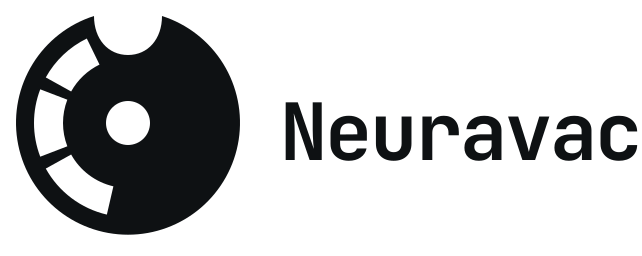
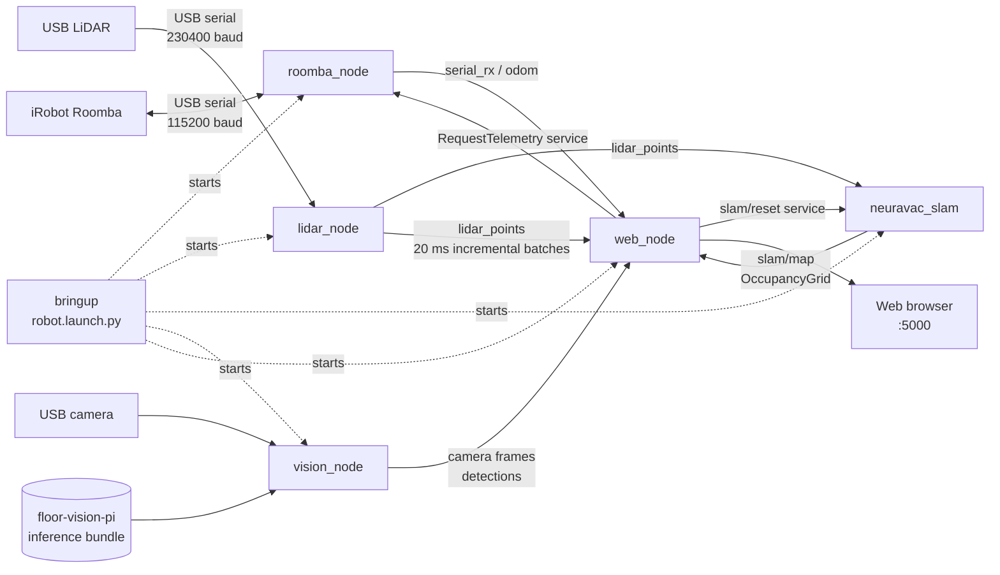

# NeuraVac

<p align="center">
  
</p>

NeuraVac is a ROS 2 robot platform built around an iRobot Roomba. It combines
direct Roomba control, USB LiDAR, camera-based floor-object detection, and a
browser dashboard into one ROS 2 workspace.

The project is designed so that hardware drivers publish and consume ROS
topics instead of depending on each other directly:

- The Roomba node owns the Roomba's Open Interface serial connection.
- The LiDAR node parses scan packets and publishes individual range points.
- The vision node publishes camera frames and object detections.
- The web node bridges ROS topics to a Flask dashboard for monitoring and
  manual control.
- The bringup package starts the complete robot with one launch command and
  provides stable USB device names.
- The interfaces package contains the messages shared by those nodes.

## System overview



The hardware nodes can run independently. ROS 2 provides the transport and
the dashboard subscribes to the topics it needs. Vision detections contain
advisory actions such as `clean`, `avoid`, and `avoid_and_review`; the vision
node does **not** drive the Roomba.

The LiDAR reader polls every 2 ms and drains all complete packets from the
serial buffer, avoiding stale packet backlogs. The dashboard streams new
points incrementally in timestamped batches of up to 20 ms; the browser draws
on its next frame and keeps a rolling 250 ms visible.

The `roomba_node` requests OI sensor group 0 twice per second and publishes
incremental wheel odometry on `/odom`. `neuravac_slam` uses that as a motion
prediction, then corrects the pose against LiDAR scans before updating
`/slam/map`. LiDAR scan matching is authoritative when it disagrees with wheel
odometry. The COIN-D6 reports clockwise angles, so SLAM reverses the angular
sign when converting returns to ROS coordinates; this keeps mapped walls
aligned as the robot rotates. When wheel odometry stops arriving, scan matching
widens its rotation search to track turns without the odometry prior. The
camera is not used for mapping. The dashboard's **Room map**
panel shows the growing map; stronger wall returns appear brighter. The map
is held in memory and starts fresh when the node restarts. Use **Reset & Remap**
in the Room map panel to clear the occupancy grid and scan-matching pose; the
next LiDAR revolutions build a fresh map from the robot's current position.
This calls `/slam/reset` (`std_srvs/srv/Trigger`). This initial scan matcher
is intended for slow mapping in small rooms; without loop closure,
long drives can drift, and moving objects can leave temporary marks.

The dashboard reads cached telemetry every five seconds and has a **Request
now** button. The `request_telemetry` ROS service requests and returns an
immediate group 0 packet. The background 2 Hz sensor reads remain enabled for odometry;
they send only a two-byte query and receive the 26-byte group 0 packet.

## ROS 2 packages

| Package | Type | Responsibility |
| --- | --- | --- |
| [`roomba`](src/roomba) | `ament_python` | Owns the Roomba serial port, publishes raw serial bytes and wheel odometry, and serves on-demand telemetry requests. See [`src/roomba/README.md`](src/roomba/README.md). |
| [`lidar`](src/lidar) | `ament_python` | Reads the LiDAR serial stream, validates packets, decodes angle/distance/intensity, and publishes points. |
| [`neuravac_slam`](src/neuravac_slam) | `ament_python` | Uses Roomba wheel odometry as a pose prior, corrects it against LiDAR scans, and publishes a 2D occupancy grid. |
| [`roomba_interfaces`](src/roomba_interfaces) | `ament_cmake` | Builds the custom ROS 2 messages shared by the nodes. |
| [`vision`](src/vision) | `ament_python` | Captures camera frames, runs the deployed floor-vision model, and publishes detections. |
| [`web`](src/web) | `ament_python` | Runs the Flask dashboard and bridges browser actions and telemetry to ROS 2. |
| [`bringup`](src/bringup) | `ament_python` | Launches the robot nodes together and creates stable USB device names. |

### Interfaces and topics

#### Roomba serial bridge

| Topic | Type | Direction | Purpose |
| --- | --- | --- | --- |
| `serial_rx` | `roomba_interfaces/msg/SerialData` | Roomba -> ROS | Raw bytes received from the Roomba. |
| `serial_tx` | `roomba_interfaces/msg/SerialData` | ROS -> Roomba | Raw bytes sent to the Roomba. |
| `odom` | `nav_msgs/msg/Odometry` | Roomba -> ROS | Wheel-odometry pose from incremental OI distance/angle reports. |
| `request_telemetry` | `roomba_interfaces/srv/RequestTelemetry` | ROS -> Roomba | Requests and returns a fresh 26-byte OI sensor group 0 response. |

`SerialData` contains a `uint8[] data` field. The Roomba node starts the
robot in safe mode and uses 115200 baud by default.

Read current telemetry from the dashboard or request an immediate sample from
ROS:

```bash
ros2 service call /request_telemetry roomba_interfaces/srv/RequestTelemetry "{}"
```

The SCI manual documents opcode 142 as the sensor request, packet code 0 as
the 26-byte all-sensor packet, and the distance/angle values as signed,
big-endian increments. The mapper treats wheel odometry as a scan-matching
prior because wheel slip can make it drift. See
[`docs/Roomba/Roomba_SCI_manual.md`](docs/Roomba/Roomba_SCI_manual.md).

#### LiDAR

| Topic or service | Type | Purpose |
| --- | --- | --- |
| `lidar_points` | `roomba_interfaces/msg/LidarPoint` | Decoded points containing `angle_deg`, `distance_mm`, and `intensity`. |
| `slam/map` | `nav_msgs/msg/OccupancyGrid` | LiDAR-only 2D room map in the `map` frame. |
| `slam/pose` | `geometry_msgs/msg/PoseStamped` | Scan-matched robot position and heading in the map frame. |
| `slam/reset` | `std_srvs/srv/Trigger` | Clears map and pose; fresh LiDAR scans recalculate the map. |

The dashboard's **Reset & Remap** button calls this service. To reset from a
terminal:

```bash
ros2 service call /slam/reset std_srvs/srv/Trigger "{}"
```

The LiDAR node expects the D6 packet format described in the source and uses
230400 baud by default.

#### Vision

| Topic | Type | Purpose |
| --- | --- | --- |
| `camera/image/compressed` | `sensor_msgs/msg/CompressedImage` | JPEG camera frames. |
| `camera/image_annotated/compressed` | `sensor_msgs/msg/CompressedImage` | JPEG frames with model annotations. |
| `camera/detections` | `roomba_interfaces/msg/VisionDetectionArray` | Object detections and advisory actions. |

See [`src/vision/README.md`](src/vision/README.md) for the model bundle,
parameters, detection labels, and deployment notes.

## Requirements

- Ubuntu/Linux with ROS 2 (the deployment documentation targets ROS 2 Jazzy)
- Python 3.10 or newer
- `colcon`, `rosdep`, and the ROS 2 packages required by the package manifests
- `pyserial` for the USB serial devices
- Flask and OpenCV for the dashboard/camera features
- A deployed `floor-vision-pi` bundle for the vision node
- User access to the serial and camera devices (`dialout` and `video` groups
  are commonly required on Linux)

The project also declares the main Python dependencies in
[`pyproject.toml`](pyproject.toml).

## Build

Source ROS 2, install dependencies, build the workspace, and source the
generated setup file:

```bash
source /opt/ros/jazzy/setup.bash
cd ~/Neuravac
rosdep install --from-paths src --ignore-src -r -y
colcon build --symlink-install
source install/setup.bash
```

When only one package is being developed, a focused build is faster:

```bash
colcon build --packages-select roomba_interfaces roomba lidar neuravac_slam vision web bringup --symlink-install
```

Build `vision` after its model bundle dependencies are installed:

```bash
colcon build --packages-up-to vision --symlink-install
```

## Configure the hardware and USB names

The Roomba and LiDAR must use different serial devices. Do not configure both
nodes to use the same `/dev/ttyUSB*` path. The bringup package supports stable
names so the devices do not swap when they are plugged in in a different
order.

Install the udev rules once. The setup command asks you to unplug and replug
the Roomba cable, LiDAR, and webcam one at a time:

```bash
sudo usermod -aG dialout,video $USER
ros2 run bringup neuravac_udev_setup --install
ls -l /dev/neuravac_*
```

Log out and back in after changing groups. The resulting device names are:

| Device | Stable path |
| --- | --- |
| Roomba serial adapter | `/dev/neuravac_roomba` |
| LiDAR serial adapter | `/dev/neuravac_lidar` |
| Webcam | `/dev/neuravac_camera` |

The serial ports and baud rates are configured in:

- [`src/roomba/config/roomba_params.yaml`](src/roomba/config/roomba_params.yaml)
- [`src/lidar/config/lidar_params.yaml`](src/lidar/config/lidar_params.yaml)

The YAML files use the stable names created by the udev setup tool. If the
rules are not installed, use `/dev/serial/by-path/...` or another stable udev
symlink instead of `/dev/ttyUSB0` and `/dev/ttyUSB1`. Cheap USB-serial
adapters without unique serial numbers are identified by their physical USB
port, so keep each adapter in the same port after setup.

## Start the robot

After building and sourcing the workspace, start the complete robot with:

```bash
source /opt/ros/jazzy/setup.bash
source ~/Neuravac/install/setup.bash
ros2 launch bringup robot.launch.py
```

This launch file starts `roomba_node`, `lidar_node`, `neuravac_slam`,
`vision_node`, and `web_node` together. Set `use_slam:=false` to disable
mapping while leaving the LiDAR view active. The Roomba and LiDAR nodes automatically retry every
three seconds if a serial device is temporarily unplugged. Open
<http://localhost:5000> from a browser on the robot or forward port 5000 over
SSH to use the dashboard.

The launch file also supports these arguments:

```bash
ros2 launch bringup robot.launch.py use_vision:=false
ros2 launch bringup robot.launch.py use_slam:=false
ros2 launch bringup robot.launch.py use_lidar:=false use_roomba:=false
ros2 launch bringup robot.launch.py use_web:=false
```

With `use_vision:=false`, the dashboard captures the webcam directly using
`camera_device`:

```bash
ros2 launch bringup robot.launch.py \
  use_vision:=false camera_device:=/dev/neuravac_camera
```

Only one process can own the webcam. When vision is enabled, `vision_node`
owns the camera and the dashboard displays the frames published on
`camera/image/compressed`.

### Start vision

Deploy the inference bundle as described in
[`src/vision/README.md`](src/vision/README.md), then start the node with its
bundle path:

```bash
ros2 run vision vision_node --ros-args \
  -p bundle_dir:=$HOME/floor-vision-pi \
  -p camera_index:=0 \
  -p inference_hz:=5.0
```

The vision node publishes detections and annotated images, but it does not
publish Roomba drive commands. Run it with the robot stationary during initial
integration and model validation.

## Inspect the ROS graph

Useful commands while the system is running:

```bash
ros2 node list
ros2 topic list
ros2 topic echo /lidar_points
ros2 topic echo /camera/detections
ros2 topic echo /serial_rx
ros2 topic hz /camera/detections
```

To confirm which nodes own a topic:

```bash
ros2 topic info /serial_tx
ros2 topic info /lidar_points
```

## Testing

Run the package tests after sourcing ROS:

```bash
colcon test --event-handlers console_direct+
colcon test-result --verbose
```

The web package also has focused unit tests:

```bash
PYTHONPATH=src/web:$PYTHONPATH python3 -m unittest discover -s src/web/tests
```

## Repository layout

```text
.
├── docs/                 Hardware manuals and NeuraVac logo assets
├── src/
│   ├── bringup/          Full-robot launch file and USB udev setup
│   ├── lidar/            LiDAR ROS 2 node and configuration
│   ├── neuravac_slam/    LiDAR scan matching and 2D occupancy mapping
│   ├── roomba/           Roomba serial ROS 2 node and configuration
│   ├── roomba_interfaces/Custom ROS 2 messages
│   ├── vision/           Camera and floor-object detection node
│   └── web/              Flask dashboard and ROS bridge
├── build/                Colcon build output (generated)
├── install/              Colcon install output (generated)
└── pyproject.toml        Python project metadata and dependencies
```

## Hardware and protocol references

The web dashboard has an **LEDs & songs** panel for the power LED and short
Roomba tunes. The editor accepts note tokens such as `C4:32 D4:32`; durations
are measured in 1/64-second units. LED and song command limits are documented
in the [SCI manual](docs/Roomba/Roomba_SCI_manual.md).

- [Roomba SCI manual](docs/Roomba/Roomba_SCI_manual.md)
- [LiDAR documentation](docs/Lidar)
- [Vision package guide](src/vision/README.md)
- [Web dashboard guide](src/web/README.md)
- [Bringup package guide](src/bringup/README.md)

## Diagnostic recordings and speed configuration

The experimental motion deskew and map tuning were rolled back after a rotation regression. The mapper and 2 Hz odometry polling now use the previous implementation.

Record a diagnostic run with `ros2 launch bringup robot.launch.py use_diagnostics:=true`. Bags are stored in `~/Neuravac/logs/` and ignored by Git. Release drive controls before stopping the launch with Ctrl+C.

Dashboard drive speeds remain configurable in `src/web/config/web_params.yaml` (mm/s). Rebuild and restart after editing configuration.
