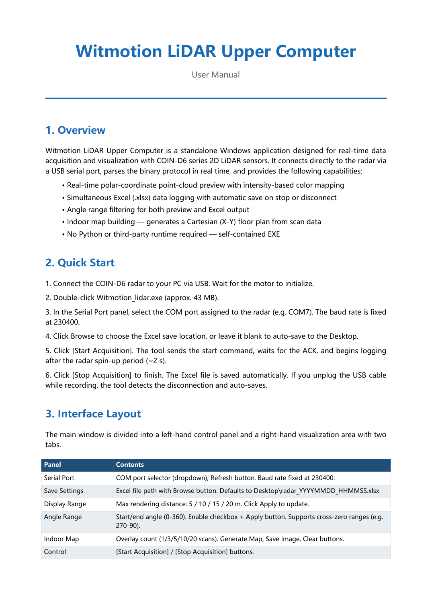
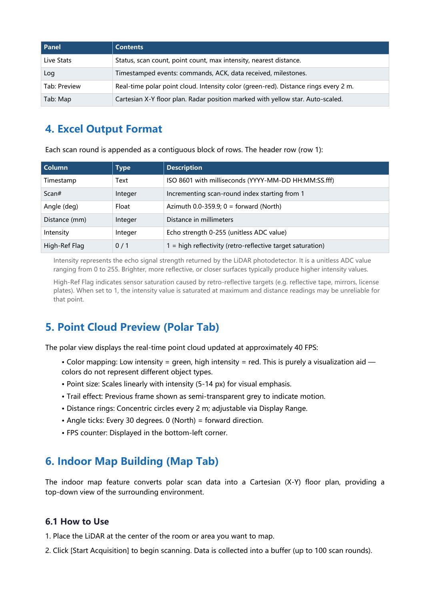
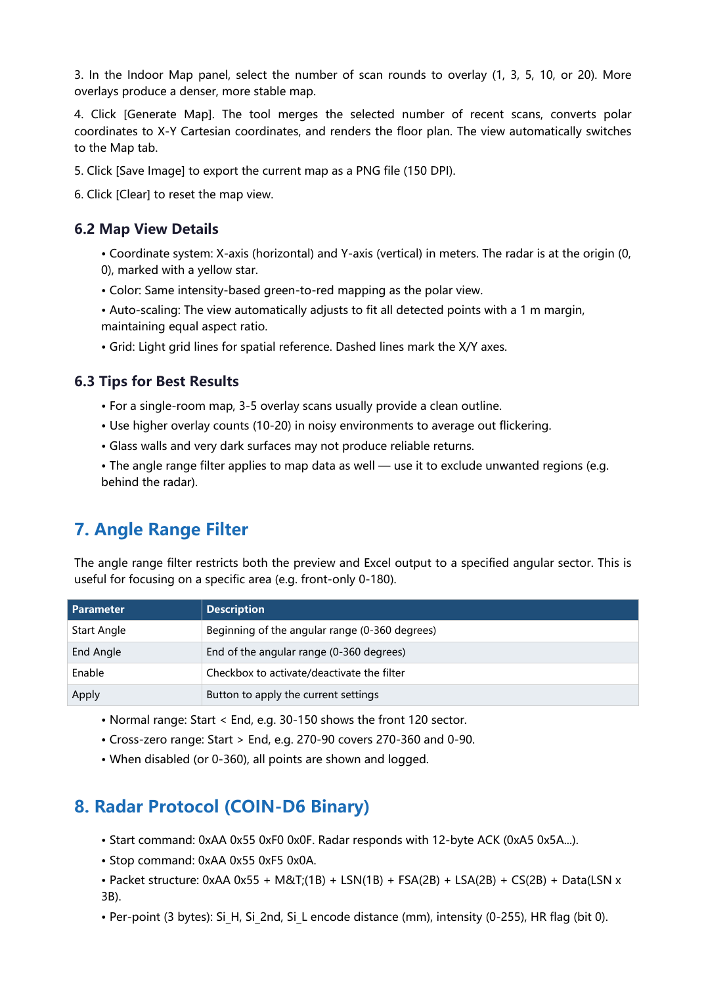
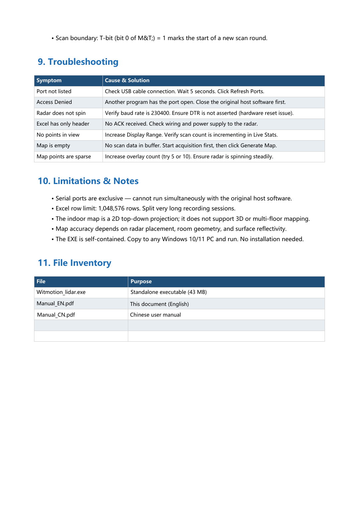

# Witmotion_LiDAR_Manual_EN

Source: [Witmotion_LiDAR_Manual_EN.pdf](../../_originals/4%20Windows%20software/New%20Host%20Computer.contents/Witmotion_LiDAR_Manual_EN.pdf).

Complete extracted text is included page by page, with spacing preserved for tables. Each page image preserves diagrams, screenshots, formatting, and any content that cannot be represented as text. Original language and wording are retained.

## Page 1

```text
              Witmotion LiDAR Upper Computer
                                                  User Manual


1. Overview
Witmotion LiDAR Upper Computer is a standalone Windows application designed for real-time data
acquisition and visualization with COIN-D6 series 2D LiDAR sensors. It connects directly to the radar via
a USB serial port, parses the binary protocol in real time, and provides the following capabilities:

        • Real-time polar-coordinate point-cloud preview with intensity-based color mapping
        • Simultaneous Excel (.xlsx) data logging with automatic save on stop or disconnect
        • Angle range filtering for both preview and Excel output
        • Indoor map building — generates a Cartesian (X-Y) floor plan from scan data
        • No Python or third-party runtime required — self-contained EXE


2. Quick Start
1. Connect the COIN-D6 radar to your PC via USB. Wait for the motor to initialize.

2. Double-click Witmotion_lidar.exe (approx. 43 MB).

3. In the Serial Port panel, select the COM port assigned to the radar (e.g. COM7). The baud rate is fixed
at 230400.

4. Click Browse to choose the Excel save location, or leave it blank to auto-save to the Desktop.

5. Click [Start Acquisition]. The tool sends the start command, waits for the ACK, and begins logging
after the radar spin-up period (~2 s).

6. Click [Stop Acquisition] to finish. The Excel file is saved automatically. If you unplug the USB cable
while recording, the tool detects the disconnection and auto-saves.


3. Interface Layout
The main window is divided into a left-hand control panel and a right-hand visualization area with two
tabs.

Panel                   Contents

Serial Port             COM port selector (dropdown); Refresh button. Baud rate fixed at 230400.

Save Settings           Excel file path with Browse button. Defaults to Desktop\radar_YYYYMMDD_HHMMSS.xlsx

Display Range           Max rendering distance: 5 / 10 / 15 / 20 m. Click Apply to update.

Angle Range             Start/end angle (0-360). Enable checkbox + Apply button. Supports cross-zero ranges (e.g.
                        270-90).

Indoor Map              Overlay count (1/3/5/10/20 scans). Generate Map, Save Image, Clear buttons.

Control                 [Start Acquisition] / [Stop Acquisition] buttons.
```



## Page 2

```text
Panel                    Contents

Live Stats               Status, scan count, point count, max intensity, nearest distance.

Log                      Timestamped events: commands, ACK, data received, milestones.

Tab: Preview             Real-time polar point cloud. Intensity color (green-red). Distance rings every 2 m.

Tab: Map                 Cartesian X-Y floor plan. Radar position marked with yellow star. Auto-scaled.


4. Excel Output Format
Each scan round is appended as a contiguous block of rows. The header row (row 1):

Column                   Type              Description

Timestamp                Text              ISO 8601 with milliseconds (YYYY-MM-DD HH:MM:SS.fff)

Scan#                    Integer           Incrementing scan-round index starting from 1

Angle (deg)              Float             Azimuth 0.0-359.9; 0 = forward (North)

Distance (mm)            Integer           Distance in millimeters

Intensity                Integer           Echo strength 0-255 (unitless ADC value)

High-Ref Flag            0/1               1 = high reflectivity (retro-reflective target saturation)

   Intensity represents the echo signal strength returned by the LiDAR photodetector. It is a unitless ADC value
   ranging from 0 to 255. Brighter, more reflective, or closer surfaces typically produce higher intensity values.

   High-Ref Flag indicates sensor saturation caused by retro-reflective targets (e.g. reflective tape, mirrors, license
   plates). When set to 1, the intensity value is saturated at maximum and distance readings may be unreliable for
   that point.


5. Point Cloud Preview (Polar Tab)
The polar view displays the real-time point cloud updated at approximately 40 FPS:

        • Color mapping: Low intensity = green, high intensity = red. This is purely a visualization aid —
        colors do not represent different object types.
        • Point size: Scales linearly with intensity (5-14 px) for visual emphasis.
        • Trail effect: Previous frame shown as semi-transparent grey to indicate motion.
        • Distance rings: Concentric circles every 2 m; adjustable via Display Range.
        • Angle ticks: Every 30 degrees. 0 (North) = forward direction.
        • FPS counter: Displayed in the bottom-left corner.


6. Indoor Map Building (Map Tab)
The indoor map feature converts polar scan data into a Cartesian (X-Y) floor plan, providing a
top-down view of the surrounding environment.


6.1 How to Use
1. Place the LiDAR at the center of the room or area you want to map.

2. Click [Start Acquisition] to begin scanning. Data is collected into a buffer (up to 100 scan rounds).
```



## Page 3

```text
3. In the Indoor Map panel, select the number of scan rounds to overlay (1, 3, 5, 10, or 20). More
overlays produce a denser, more stable map.

4. Click [Generate Map]. The tool merges the selected number of recent scans, converts polar
coordinates to X-Y Cartesian coordinates, and renders the floor plan. The view automatically switches
to the Map tab.

5. Click [Save Image] to export the current map as a PNG file (150 DPI).

6. Click [Clear] to reset the map view.


6.2 Map View Details
        • Coordinate system: X-axis (horizontal) and Y-axis (vertical) in meters. The radar is at the origin (0,
        0), marked with a yellow star.
        • Color: Same intensity-based green-to-red mapping as the polar view.
        • Auto-scaling: The view automatically adjusts to fit all detected points with a 1 m margin,
        maintaining equal aspect ratio.
        • Grid: Light grid lines for spatial reference. Dashed lines mark the X/Y axes.


6.3 Tips for Best Results
        • For a single-room map, 3-5 overlay scans usually provide a clean outline.
        • Use higher overlay counts (10-20) in noisy environments to average out flickering.
        • Glass walls and very dark surfaces may not produce reliable returns.
        • The angle range filter applies to map data as well — use it to exclude unwanted regions (e.g.
        behind the radar).


7. Angle Range Filter
The angle range filter restricts both the preview and Excel output to a specified angular sector. This is
useful for focusing on a specific area (e.g. front-only 0-180).

Parameter                   Description

Start Angle                 Beginning of the angular range (0-360 degrees)

End Angle                   End of the angular range (0-360 degrees)

Enable                      Checkbox to activate/deactivate the filter

Apply                       Button to apply the current settings

        • Normal range: Start < End, e.g. 30-150 shows the front 120 sector.
        • Cross-zero range: Start > End, e.g. 270-90 covers 270-360 and 0-90.
        • When disabled (or 0-360), all points are shown and logged.


8. Radar Protocol (COIN-D6 Binary)
        • Start command: 0xAA 0x55 0xF0 0x0F. Radar responds with 12-byte ACK (0xA5 0x5A...).
        • Stop command: 0xAA 0x55 0xF5 0x0A.
        • Packet structure: 0xAA 0x55 + M&T;(1B) + LSN(1B) + FSA(2B) + LSA(2B) + CS(2B) + Data(LSN x
        3B).
        • Per-point (3 bytes): Si_H, Si_2nd, Si_L encode distance (mm), intensity (0-255), HR flag (bit 0).
```



## Page 4

```text
       • Scan boundary: T-bit (bit 0 of M&T;) = 1 marks the start of a new scan round.


9. Troubleshooting

Symptom                    Cause & Solution

Port not listed            Check USB cable connection. Wait 5 seconds. Click Refresh Ports.

Access Denied              Another program has the port open. Close the original host software first.

Radar does not spin        Verify baud rate is 230400. Ensure DTR is not asserted (hardware reset issue).

Excel has only header      No ACK received. Check wiring and power supply to the radar.

No points in view          Increase Display Range. Verify scan count is incrementing in Live Stats.

Map is empty               No scan data in buffer. Start acquisition first, then click Generate Map.

Map points are sparse      Increase overlay count (try 5 or 10). Ensure radar is spinning steadily.


10. Limitations & Notes
       • Serial ports are exclusive — cannot run simultaneously with the original host software.
       • Excel row limit: 1,048,576 rows. Split very long recording sessions.
       • The indoor map is a 2D top-down projection; it does not support 3D or multi-floor mapping.
       • Map accuracy depends on radar placement, room geometry, and surface reflectivity.
       • The EXE is self-contained. Copy to any Windows 10/11 PC and run. No installation needed.


11. File Inventory

File                                 Purpose

Witmotion_lidar.exe                  Standalone executable (43 MB)

Manual_EN.pdf                        This document (English)

Manual_CN.pdf                        Chinese user manual
```



