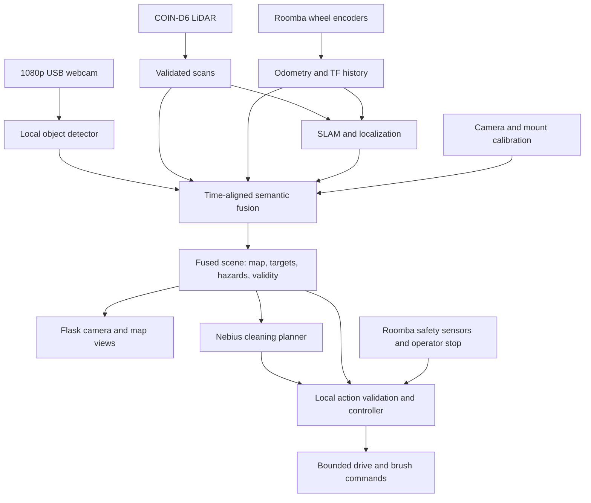

# NeuraVac Sensor Fusion Implementation Plan

**Goal:** Build one local perception system that combines COIN-D6 LiDAR, Roomba wheel odometry, and 1080p USB webcam detections into a localized map of obstacles, cleaning targets, and hazards; use NVIDIA Nemotron on Nebius to select and explain cleaning priorities.

**Status:** Proposed unified roadmap, October 11, 2026. Replaces the separate vision and mapping checklists. Hardware performance, calibration, model accuracy, and fusion accuracy require measurement. Start with stationary camera inference, then validate the LiDAR and odometry before moving into SLAM and fusion.

## How the sensors work together

| Source | Contribution | Limits / fusion rule |
| --- | --- | --- |
| COIN-D6 LiDAR | Measured geometry, scan matching, occupancy, obstacle ranges at scanner height | One horizontal plane; can miss floor debris, cables, glass, and drop-offs |
| Wheel encoders | Continuous short-term robot motion estimate | Calibrate scale/track; account for rollover, slip, resets, and missing samples |
| USB webcam + object detector | Debris/hazard identity and image location | A box is not depth; use calibrated floor geometry or a verified LiDAR association |
| Roomba bump/cliff/wheel-drop sensors | Immediate local motion veto | Override map, vision, planner, and operator drive requests |
| Nebius NVIDIA model | High-level target selection and task explanation from the fused scene | No direct motor commands, SLAM authority, or emergency-stop responsibility |

Two fusion stages are planned. First, `slam_toolbox` uses LiDAR scans and wheel-odometry transforms to estimate map-relative pose. Second, a local fusion node projects timestamped camera detections into that map, associates compatible LiDAR returns, and maintains semantic targets and hazard regions. Camera detections do not become an additional pose measurement in this MVP; visual odometry and an IMU are optional later additions.

## Shared stack and scope

- **Proposed shared OS:** Ubuntu Server 24.04 arm64 + ROS2 Jazzy, headless, for both vision and mapping. Verify OpenCV/V4L2, NCNN, UART, and Roomba access together before adopting it. If preserving Raspberry Pi OS is necessary, evaluate a ROS2 container/source build and record one consistent runtime choice. [Jazzy platform support](https://www.openrobotics.org/blog/2024/5/ros-jazzy-jalisco-released)
- **Vision:** Start with YOLO26n + NCNN at 320/416 input; try 640 for small-object recall. YOLO11n is a compatibility fallback; EfficientDet-Lite0 INT8 is a measured alternative if needed. Record versions, checksums, and licenses. Capture 1920×1080, resize/letterbox for inference, and map boxes back; benchmark 720p capture if decoding/transfer becomes limiting. [Pi deployment guide](https://docs.ultralytics.com/guides/raspberry-pi/) · [EfficientDet-Lite0](https://developers.google.com/edge/mediapipe/solutions/vision/object_detector)
- **Mapping:** `slam_toolbox` asynchronous 2D SLAM, wheel odometry, measured static transforms, and saved pose-graph localization. Start with one room, supervised low-speed driving, and a 0.05 m occupancy grid. [SLAM Toolbox](https://github.com/SteveMacenski/slam_toolbox/blob/ros2/README.md)
- **Hardware:** Benchmark the existing Pi 4 B / 4 GB first. Use Pi 5 / 8 GB only if the complete workload fails the combined gates. GPU training/export runs off-board; onboard inference, fusion, SLAM, stops, and control stay local.
- **MVP:** map one room, localize, show fused debris/hazards, let Nebius select a known target, execute a validated short approach, clean, and rescan. Full automatic exploration, room-wide coverage planning, docking, voice control, liquids, and pet-waste recognition are later work. A map alone is not a navigation system.

## Proposed component boundaries

| Location | Responsibility |
| --- | --- |
| `src/vision/`, `ml/`, `scripts/benchmark_vision.py` | Capture/replay, inference, original-image boxes, GPU training/export, benchmarks |
| `ros2_ws/src/neuravac_lidar/` | D6 protocol, scan assembly, acquisition timing, diagnostics |
| `ros2_ws/src/neuravac_robot/` | Single Roomba serial owner, sensors, odometry, bounded commands and stops |
| `ros2_ws/src/neuravac_description/` | Robot geometry and calibrated sensor transforms |
| `ros2_ws/src/neuravac_fusion/` | Time alignment, projection/association, tracked semantic scene and validity |
| `ros2_ws/src/neuravac_bringup/` | Shared sensor, calibration, SLAM, and fusion configuration/launch |
| `src/mapping/bridge.py`, `website/` | Backend scene bridge and camera/map display |
| `src/planner/` | Nebius client, structured plans, action validation against the current scene |
| `maps/`, `docs/` | Map artifacts/manifests, setup, calibration, labeling and measured results |

These are proposed files, not existing implementations. Reuse `src/sensors.py` decoding and `src/roomba.py` command behavior through tested imports instead of creating competing serial clients.

## Hardware reference facts

| Item | Documented COIN-D6 value / integration consequence |
| --- | --- |
| Sensor | Single-plane 360° dToF LiDAR |
| Range | 0.05–12 m advertised maximum; usable range depends on reflectivity |
| Sampling / rotation | Nominal 4,000 points/sec; typical 10 Hz rotation; specification lists 15 Hz maximum, protocol describes fixed 10 Hz |
| Angular resolution | Typical 0.9°; validate actual sample spacing and scan count |
| Serial | 230400 baud, 8 data bits, 1 stop bit, no parity; 3.3 V LVTTL |
| Power | Nominal 5 V; A1 sheet lists 800 mA peak current; include startup margin in the power budget |
| Start / stop | `AA 55 F0 0F` / `AA 55 F5 0A` |
| Coordinates | Vendor angles increase clockwise; convert to ROS conventions and verify physically |
| Optical plane | Emission point 26.9 mm above sensor base; keep the optical window unobstructed |

Local sources:

- [LiDAR documentation index](docs/Lidar/README.md)
- [Instruction manual](docs/Lidar/COIN-D6%20Instruction%20Manual.md)
- [A1 specification](docs/Lidar/1%20D6%20LiDAR%20Manual/COIN-D6%20Single-Line%20LiDAR%20Specification%20Sheet%20A1.md)
- [English protocol](docs/Lidar/1%20D6%20LiDAR%20Manual/COIN-D6%20LiDAR%20Data%20Format%20Standard%20Specification%20V1.0%28EN%29.md), with Chinese original alongside it for equation checks
- [Vendor checksum example](docs/Lidar/4%20Windows%20software/calibration.md)
- [ROS setup guide](docs/Lidar/2%20ROS%20and%20ROS2%20feature%20pack%20information/Tucker%20Innovations%20%20Guoke%20Optoelectronics%20D6%20ROS%20Driver%20Package%20User%20Guide%20V1.0.md)
- [Extracted ROS2 driver source](docs/Lidar/2%20ROS%20and%20ROS2%20feature%20pack%20information/m1ct_d4_ros2_v16.md)

The supplied ROS2 package is internally named `m1ct_d2`. Its defaults include 0.01–16 m range, sample rate 9, `isToFLidar: false`, and `reversion: true`; do not treat those as verified D6 settings. Its timing helper uses `steady_clock`, and the scan publisher copies that value into a ROS header. Its package license is also unfinished. Compatibility, timestamps, orientation, and redistribution permissions must be checked before reuse.

## Phase 1 — Stationary camera baseline FIRST

### 1. Confirm hardware and get floor images

- [ ] Record the Pi model, RAM, OS, Python version, cooling, power supply, and available disk space in `docs/vision-setup.md`.
- [ ] Record the 1080p USB webcam's make/model, supported capture formats and frame rates, and device path. Verify OpenCV/V4L2 can capture actual 1920×1080 frames; do not assume the webcam accepted requested settings.
- [ ] Mount the camera facing ahead and slightly downward, with the approach area visible before an object reaches the brushes. Measure mount height, tilt, and usable viewing distance.
- [ ] Capture a short floor-level video and still images with the robot stationary. Check focus, blur, shadows, glare, carpet, tile, and wood where available.
- [ ] Check power stability with the camera active. Keep the robot stationary and brushes off throughout this phase.

**Deliverable:** Repeatable camera capture and a small collection of real robot-view images.

### 2. Deploy and benchmark a pretrained baseline

- [ ] Create a Python environment and record compatible dependency versions in `requirements-vision.txt`; avoid an unpinned install in the final setup instructions.
- [ ] Load YOLO26n pretrained weights on a development machine and verify still-image inference. Record the weights' source, version, checksum, and license.
- [ ] Export NCNN artifacts for the input sizes under test and copy them to the Pi. Do training/export off-board where practical.
- [ ] Implement `src/vision/camera.py` for the USB webcam and prerecorded video replay, with configurable device, capture resolution, and frame rate; use a latest-frame buffer so slow inference does not build an old-frame queue.
- [ ] Implement `src/vision/detector.py` to return labels, scores, and boxes in original-frame coordinates, including undoing resize/letterbox transforms.
- [ ] Implement `src/vision/run.py` as a stationary CLI demo: annotate images/video, save detections as JSONL, and make no motor calls.
- [ ] Implement `scripts/benchmark_vision.py` to compare input sizes and thread counts on the same saved clip, then repeat with live capture.
- [ ] Measure capture-to-result latency (median/p95), processed FPS, CPU, peak memory, temperature/throttling, dropped frames, and model-only inference time separately.
- [ ] Run a 15-minute benchmark with the Flask UI and available sensor workloads active; make the final hardware decision after the combined fusion benchmark; repeat after any model/runtime change.

**Provisional hardware gate:** At least 3 processed frames/sec, capture-to-result p95 ≤ 400 ms, total system memory use < 3 GB on the 4 GB board, and no sustained thermal throttling or sensor starvation. These are engineering targets, not claimed results; they do not establish safe driving speed.

- [ ] Provisionally keep Pi 4 if it meets the gate at a resolution that also meets Phase 4 accuracy targets; finalize the board choice using Phase 9's combined workload.
- [ ] If it misses: first reduce stale-frame backlog, tune resolution/threads, and limit preview load; benchmark the INT8 alternative if needed.
- [ ] If it still misses, benchmark the same model and clip on Pi 5 / 8 GB; validate SLAM and fusion on that board too before committing to the hardware change.

**Deliverable:** Local camera → boxes + JSON demo and a provisional Pi 4 / Pi 5 assessment. Stock-model results validate the pipeline, not crumb/cable recognition.

## Phase 2 — LiDAR bring-up and validated scans

- [ ] Confirm physical sensor model/revision and choose direct Pi UART or a USB adapter using the [UART wiring guide](docs/Lidar/raspberry-pi-uart.md). Record the adapter, cable, power source, and port in `docs/mapping-setup.md`.
- [ ] Check actual connector pinout against the manual and adapter; sensor TX connects to host RX. Keep 5 V supply separate from 3.3 V UART logic.
- [ ] Mount the scanner rigidly and approximately level above the vacuum, with the scan plane clear of the webcam, supports, and robot body. Measure the sensor pose relative to the robot center.
- [ ] Assign separate, stable interfaces to LiDAR and Roomba. Verify GPIO UART routing when used; for USB adapters prefer `/dev/serial/by-id` when unique or physical-port rules otherwise. Test both connected after reboot.
- [ ] Open the LiDAR port at 230400/8N1, send Start, allow spin-up, and capture raw bytes with host timestamps. Send Stop on exit; distinguish acknowledgments, startup bytes, and scan packets.
- [ ] Verify packet structure/checksums against the protocol and vendor example, using real captures. Resolve conflicting or garbled documentation against the Chinese equations and captured data before coding assumptions.
- [ ] Observe a wall and objects placed at known forward/left/right positions. Check distance scale, zero direction, rotation direction, range gaps, and measured scan frequency.
- [ ] Record a 10-minute stationary capture and diagnostics: valid/invalid packets, incomplete revolutions, reconnects, and timing gaps.

**Gate:** Stable stationary scans with correct distances/orientation and no unexplained packet failures. No autonomous motion yet.

### Publish correct ROS2 scans

**Proposed files:** `ros2_ws/src/neuravac_lidar/` for the verified driver; `ros2_ws/src/neuravac_bringup/config/lidar.yaml` for hardware settings; `docs/mapping-setup.md` for reproducible setup. Leave reference files in `docs/Lidar` intact.

- [ ] Select the shared OS/runtime and build the driver on arm64. Record upstream version/hash, local modifications, and license information if adapting vendor code.
- [ ] Set D6-specific range bounds initially to 0.05–12 m and nominal 10 Hz; measure usable range and correct model/mode switches based on actual protocol behavior.
- [ ] Parse variable-length packets across partial serial reads. Check declared sample counts and full packet length before validating checksum; recover from noise without publishing corrupted points.
- [ ] Assemble revolutions using the start flag and angle wraparound. Handle one-sample packets, missing packets, startup acknowledgments, disconnects, and dropped partial scans.
- [ ] Publish `sensor_msgs/LaserScan` in `laser_link`, with distances in metres, angles in radians, zero along +X, and angles increasing counterclockwise about +Z. Test forward/left/right targets; prevent double reversal/correction.
- [ ] Represent invalid/missing beams without treating them as zero-distance obstacles or observed free space. If resampling onto uniform angular bins, define the binning and conservative range policy; do not interpolate across unseen sectors.
- [ ] Audit timestamps: use the active ROS clock for scan acquisition time and a monotonic clock for elapsed durations. Match odometry/TF to the same time domain. Document UART/USB arrival-time uncertainty and any acquisition-time estimate.
- [ ] Make `scan_time`, `time_increment`, beam ordering, and header time describe the same acquisition sequence. Clockwise hardware plus counterclockwise output requires careful timing/order handling; do not blindly reverse samples while retaining old timing fields.
- [ ] Validate angle bounds, increment, and array length consistency; compatible publisher/subscriber QoS; bounded queues; and no increasing observation backlog. Follow the [ROS LaserScan contract](https://github.com/ros2/common_interfaces/blob/jazzy/sensor_msgs/msg/LaserScan.msg).
- [ ] Visualize scans in RViz and record `/scan`, diagnostics, `/tf`, and `/tf_static` with rosbag2. Prove a saved capture can be replayed using simulated ROS time.

**Gate:** Correct, timestamped `/scan` at approximately the measured nominal rate; explicit diagnostics when observations become stale or invalid.

## Phase 3 — Wheel odometry, common clock, and sensor calibration

**Proposed files:** `ros2_ws/src/neuravac_robot/` for the serial owner, odometry, and command bridge; `ros2_ws/src/neuravac_description/urdf/neuravac.urdf.xacro` for robot geometry; `ros2_ws/src/neuravac_bringup/launch/sensors.launch.py` for launch wiring.

- [ ] Reuse `src/sensors.py` decoding through a tested import/package boundary and `src/roomba.py` command behavior where appropriate. One service owns the Roomba port, including motion and sensor queries; no parallel standalone polling client.
- [ ] Confirm actual model/firmware and encoder support. Prefer supported left/right encoder counts over commanded speeds; distance/angle packet deltas are a fallback requiring independent validation.
- [ ] Obtain model-specific wheel diameter, axle track, and encoder scale; calibrate using measured straight runs and turns. Do not copy geometry from the older SCI manual without checking the actual Roomba.
- [ ] Handle 16-bit encoder rollover, backward travel, initial samples, reset/reconnect, impossible jumps, slip, and missing data. Integrate differential-drive pose and measured velocities with realistic uncertainty.
- [ ] Target 20 Hz odometry initially, then measure sustainable polling rate and response latency. The existing CLI defaults to one second between polls; do not assume it already provides timely odometry.
- [ ] Publish `/odom` as `nav_msgs/Odometry` and the continuous `odom → base_link` transform with matching timestamps. Publish the measured static `base_link → laser_link` and webcam mounting transform.
- [ ] Give every TF edge one publisher. SLAM owns `map → odom`; wheel odometry owns `odom → base_link`. This is the standard frame separation. [Nav2 state estimation guide](https://docs.nav2.org/rolling/getting_started/navigation_concepts/state_estimation/)
- [ ] Verify metre/radian units and signs: forward travel increases local X, a left turn increases yaw, and LiDAR returns align while moving slowly.
- [ ] Connect operator controls through command arbitration, Safe mode, explicit zero-velocity stop, and command timeout before mapping drives. Stop when encoder/sensor data or required TF becomes stale; do not fabricate motion through missing data.

**Gate:** Valid `odom → base_link → laser_link` at scan acquisition times, with calibrated wheel odometry and supervised low-speed control. If encoders are unusable, evaluate an independent LiDAR-odometry source before continuing; identity transforms are not a substitute for odometry.

### Shared observation contract and calibration

- [ ] Publish stamped camera images/camera calibration and detections alongside `/scan`, `/odom`, `/tf`, `/tf_static`, and safety observations. Each detection carries image ID, capture time, receipt time, source dimensions, model version, class, score, and original-frame `xyxy` box.
- [ ] Use one ROS time domain across nodes; use monotonic durations for watchdogs. Estimate webcam buffering and LiDAR transport/acquisition offsets; document timing uncertainty. TF lookups use acquisition time rather than inference completion time. Bags use `/clock` with `use_sim_time` on all participating nodes.
- [ ] Maintain bounded pose/scan history long enough for the measured inference delay. Initially gate image/scan associations to ≤ 100 ms acquisition-time separation; motion-compensate to a common time using odometry and reject missing TF, excessive uncertainty, or unmatched data. Tune this limit from measured motion and error.
- [ ] Calibrate webcam intrinsics and distortion at the deployed capture mode; record focus/zoom settings. Measure `base_link → laser_link`, `base_link → camera_link`, and `camera_link → camera_optical_frame`. Camera optical axes differ from robot axes; verify the full chain physically.
- [ ] Store versioned calibration in `ros2_ws/src/neuravac_bringup/config/calibration.yaml`. Validate against surveyed floor targets and LiDAR-visible landmarks; repeat when the mount, focus, crop, or capture mode changes. Calibration and projection follow [OpenCV's camera model](https://docs.opencv.org/4.x/d9/d0c/group__calib3d.html).

**Calibration gate:** Known targets project into the correct camera/map regions at multiple distances; acquisition-time transforms exist; observed timing and geometric errors are recorded before enabling semantic fusion.

## Phase 4 — Train and evaluate vacuum-specific vision

Initial label set:

| Detection class | Intended behavior |
| --- | --- |
| `dry_debris` | Clean visible patches of crumbs, cereal, or similar safe dry debris |
| `cable` | Avoid; do not let brushes reach it |
| `sock` | Avoid loose fabric that can jam brushes |
| `small_obstacle` | Avoid defined solid objects such as toys or shoes |

These are custom labels. An empty prediction does not prove that a path is clear. Unknown scenes require conservative local behavior; a closed-set detector does not reliably identify every unknown object.

- [ ] Write `docs/vision-labeling.md`: examples, minimum visible object size, partial occlusion rules, and a consistent box policy for debris patches versus individual pieces.
- [ ] Collect an initial 500–1,000 labeled images from the mounted camera, including clean floors and confusing backgrounds. Treat this as a starter dataset, not a guaranteed sufficient size.
- [ ] Include objects at different distances/orientations, thin and low-contrast cables, carpet patterns, shadows, chair legs, and motion blur.
- [ ] Label all target objects per image. Keep clean-floor images with no boxes as negative examples; do not label the entire image as an object.
- [ ] Split approximately 70% train / 15% validation / 15% test by recording session or room, keeping adjacent video frames in the same split.
- [ ] Add object instances and a recording session to the test set that were never used for training or threshold tuning.
- [ ] Track class counts, recording IDs, collection settings, and dataset/model licenses. Keep large raw datasets outside Git and document their location.
- [ ] Store the dataset manifest and class configuration in `ml/dataset.yaml` with reproducible preparation instructions.

**Deliverable:** A labeled floor-view dataset with a genuinely held-out test set.

### Fine-tune and evaluate the Pi model

- [ ] Fine-tune the chosen nano detector on a GPU using `ml/train.py`; record seed, data split, parameters, dependency versions, and training logs.
- [ ] Evaluate per-class precision/recall and mAP, plus missed hazards, false cleaning targets, and clean-floor false positives. Break results down by distance, lighting, and floor type.
- [ ] Tune class-specific confidence thresholds on validation data, then freeze them before test evaluation. Favor recall for cables/socks and precision for cleanable debris.
- [ ] Initial acceptance targets within the declared visible approach area: ≥ 95% recall for cable/sock hazards and ≥ 90% precision for dry-debris targets. Report test counts and uncertainty; small demo sets do not establish general reliability.
- [ ] Inspect false negatives and collect more real images where the model fails. Increase input resolution only if the resulting recall benefit justifies its latency cost.
- [ ] Export the fine-tuned weights with `ml/export.py`; compare exported-model detections with the training-format model on the same test images.
- [ ] Repeat the complete Pi benchmark with the custom model and update the board/runtime assessment before the combined benchmark.
- [ ] Write `docs/vision-results.md` with accuracy, performance, class limitations, recommended thresholds, and the exact model artifact used.

**Deliverable:** A vacuum-specific detector running locally, with measured accuracy and latency.

## Phase 5 — One-room SLAM and saved map

**Proposed files:** `ros2_ws/src/neuravac_bringup/config/slam.yaml`, `ros2_ws/src/neuravac_bringup/launch/mapping.launch.py`, `maps/README.md`, and `docs/mapping-results.md`.

- [ ] Launch `slam_toolbox` with `scan_topic: /scan`, `base_frame: base_link`, `odom_frame: odom`, `map_frame: map`, mapping mode, and initial map resolution 0.05 m/cell. Tune from a saved bag rather than changing multiple settings during a drive.
- [ ] Manually drive one slow loop through a small room, revisit the start, and record all observations/transforms. Include pauses and slow turns to limit scan distortion.
- [ ] Inspect alignment of walls and corners, loop closure, robot pose, unknown cells, scan overlap, and transform failures. Fix timing/extrinsic/odometry errors before compensating with permissive SLAM settings.
- [ ] Compare at least three measured room dimensions and return-to-start position against map/pose estimates. Initial demo targets: dimensions within 0.10 m or 3%, whichever is larger; return pose within 0.15 m and 10°. Report method and all trial results.
- [ ] Save both the occupancy image + YAML metadata and the serialized pose graph. Record robot calibration, software versions, frame names, resolution, map ID, and date; a map image alone does not preserve a resumable SLAM session.
- [ ] Replay the same bag with `/clock` and `use_sim_time` enabled on every relevant node. Check map quality without hardware and keep the bag outside Git if large.

**Gate:** A repeatable one-room map with demonstrated loop closure and saved artifacts that can be loaded again.

## Phase 6 — Fuse vision, LiDAR, and pose into a semantic scene

This is the integration milestone: one scene used by the UI, local controller, and Nebius. Keep geometric occupancy, transient obstacles, semantic targets, and no-go regions as separate layers so their evidence, uncertainty, and lifetimes remain inspectable.

- [ ] Implement `neuravac_fusion` with a scene contract: scene version, map ID/revision, calibration/model versions, robot pose/validity, source times, geometric occupancy, target IDs, class scores, estimated positions/regions, positional uncertainty, depth method, source observation IDs, last-seen time, and expiry.
- [ ] For visible debris lying on the calibrated flat floor, undistort a defined ground-contact point/region and intersect its camera ray with the floor plane. Reject points near the horizon, outside the validated area, on non-flat terrain, or without a usable pose; boxes alone do not supply depth.
- [ ] For objects intersecting the LiDAR plane, transform timestamped LiDAR returns into the camera optical frame and project them into the image. Require a spatially consistent cluster, plausible range, temporal agreement, and ambiguity/occlusion checks before associating it with a detection. Do not assign a background wall's depth merely because it projects inside a box.
- [ ] Compare floor and LiDAR estimates only when they describe the same physical surface/contact geometry. Otherwise retain separate evidence; conflicting evidence cannot be resolved by blindly averaging distances or detector scores.
- [ ] If no reliable depth exists, retain an unlocalized visual hazard with a conservative local stop/slow policy; do not invent a map target. LiDAR free space cannot erase a camera cable/sock hazard below the scan plane. Absence of detections cannot establish clear floor.
- [ ] Propagate calibration, timing, depth, and pose uncertainty into target regions. Keep class confidence separate from positional uncertainty; inflate no-go regions by robot/brush footprint and stopping margin.
- [ ] Associate repeated observations using class, spatial uncertainty, and time; maintain stable target IDs and avoid duplicate requests. Expire transient objects, require new evidence after scene changes, and preserve unresolved hazard holds until a current observation or operator clears them.
- [ ] On loop closure, map reload, or relocalization: pause target execution, then reproject targets from retained source observations/keyframes or invalidate them. Never silently keep obsolete coordinates or mix map revisions.
- [ ] Record fused scenes and source observations for deterministic replay, including accepted/rejected associations and reasons. Display provenance/uncertainty and association overlays for debugging.
- [ ] Validate with surveyed crumbs/cable/sock/toy placements: include correct LiDAR associations, floor-only targets, ambiguous wall background, motion, occlusion, stale data, and conflicting sensors. Initial target-position p95 ≤ 0.10 m within the declared approach region; report association precision and all failures, not just successful overlays.

**Gate:** One replayable scene puts supported debris/hazards in the correct map regions, rejects unreliable associations, survives loop closure correctly, and retains low-object hazards even when LiDAR reports free space.

## Phase 7 — Localization and shared website display

- [ ] Load the saved pose graph in `slam_toolbox` localization mode and verify the version-specific initial-pose/relocalization workflow. Do not run a second localization system publishing the same `map → odom` edge.
- [ ] Test restart at a known location and relocation to another known location. Require a verified pose before resuming autonomous tasks; fresh TF alone is not proof of correct localization.
- [ ] Implement `src/mapping/bridge.py` to send occupancy data, map origin/resolution, map ID, timestamped robot pose, scans, and diagnostics to Flask. Keep ROS2 device/control access in the backend.
- [ ] Update `website/app.py`, `website/static/canvas.js`, and the existing LIDAR canvas. Draw occupied/free/unknown cells separately, point returns, robot footprint and heading, and path history in a consistent map frame.
- [ ] Replace the current fixed 10 m × 8 m assumptions and screen-aligned centered robot icon. Apply map origin translation/rotation, metres-to-pixels scaling, and canvas Y inversion; draw raw scan points without joining unrelated returns into walls.
- [ ] Throttle UI updates independently of scan processing. Show mapping/localizing/lost/stale states, map ID, and pose age; never display an old pose as current.
- [ ] Add map save/load controls and test restart/reload without accidentally mixing poses or overlays from different maps.

**Gate:** The website shows the saved/live occupancy map and the moving robot at the correct position and heading, including clear loss-of-localization behavior.

- [ ] Add the annotated camera view, projected LiDAR associations, semantic target/hazard regions, uncertainty, scene/map revision, and sensor-age indicators to the same UI. Camera and map overlays must reference the same fused scene; show unavailable depth or pose explicitly.

## Phase 8 — Local decisions, bounded cleaning, and Nebius

### Execute against the fused scene

- [ ] One local controller arbitrates operator input and plans through the single Roomba serial owner. Verify actual model/firmware, Safe mode, and supported brush/vacuum commands independently.
- [ ] Review `stop_roomba()` before reuse: make zero velocity explicit before passive mode/serial close. Implement command expiry, operator stop, camera/scan/pose/safety-data watchdogs, bumper/cliff/wheel-drop vetoes, and shutdown stops before autonomous movement.
- [ ] Permit a short approach only when localization and the target are valid, the corridor is observed, and all hazard layers agree it is permissible. Uncertainty or any safety veto stops progression. Verify measured stopping distance and visibility requirements before setting speed limits.
- [ ] Demonstrate select target → approach → activate cleaning → rescan → confirm outcome. Track approximate cleaned coverage using actual brush footprint and validated trajectory, including pose uncertainty; visited cells are not proof of pickup.
- [ ] Implement or verify a local short-segment obstacle-aware motion primitive for the bounded demo. Treat Nav2 point-to-point navigation, automatic exploration, full coverage planning, and docking as later stages after map/localization/fusion gates pass.

### Nebius high-level planner

Keep this phase at roadmap level until the fused scene is measured. Nebius lists NVIDIA Nemotron models in its Token Factory cookbook; select the exact available model ID and verify access when implementing. [Nebius Nemotron examples](https://github.com/nebius/token-factory-cookbook/blob/main/models/nemotron/README.md)

- [ ] Configure Token Factory credentials through environment variables, with an `.env.example` containing names only and secrets excluded from Git.
- [ ] Start with a fast NVIDIA Nemotron model for structured cleaning plans; compare a larger reasoning model only if the smaller model fails representative tasks.
- [ ] Implement `src/planner/nebius_client.py` and `src/planner/schema.py`. Send the fused scene version/map ID, validated targets and their uncertainty/provenance, hazard regions, localization validity, battery, task progress, and operator instructions.
- [ ] Keep text-only reasoning text-only. Add image crops later only through a separately verified vision-capable endpoint/model.
- [ ] Require a response containing one allowed action (`select_target`, `skip_target`, `pause`, or `finish`), a known target ID when applicable, a scene version/map ID, expiry, and a short explanation.
- [ ] Reject unknown targets, expired/malformed responses, and actions conflicting with local hazards or operator controls. Local code converts approved targets into bounded motor actions.
- [ ] Call on meaningful scene/task changes; deduplicate repeated events and allow only one active planning request. Record request latency, usage/cost, and accepted/rejected decisions.
- [ ] On timeout, network loss, or planner error: stop autonomous progression, retain manual control, and show offline status. Revalidate every response against the current fused scene, localization, and hazard layers before movement.
- [ ] Display the planner's explanation and decision trace in the UI, e.g. “Clean the visible debris patch; skip the cable region.”

**Deliverable:** A working edge/cloud loop where Nebius contributes real target selection and task reasoning.

## Phase 9 — Combined performance and fusion verification

- [ ] Benchmark mapping alone, then SLAM + fusion + 1080p USB capture + the custom detector + Flask + odometry + planner requests on Pi 4 for 20 minutes. Capture CPU, total memory, temperature, scan/odom rates, TF failures, and sensor-to-pose latency.
- [ ] Initial combined targets: ≥ 8 valid scans/sec for a measured 10 Hz sensor; odometry ≥ 15 Hz; pose output age p95 ≤ 300 ms; no growing queues, sustained throttling, or swapping; total RAM < 3 GB on Pi 4. Also require vision ≥ 3 FPS and capture-to-result p95 ≤ 400 ms. Measure image/scan-to-fused-scene latency separately; initially target p95 ≤ 500 ms, with no stale targets accepted by control. These are provisional performance gates, not safe-driving guarantees.
- [ ] Reduce preview/update load and tune bounded scan processing before reducing sensor availability. If both mapping and vision targets cannot be met, benchmark the same workload on Pi 5 / 8 GB and document the decision.
- [ ] Driver tests: partial/corrupt packets, exact checksum vectors from real captures, angle wrap, single-sample packets, incomplete revolutions, disconnect recovery, and forward/left/right fixtures.
- [ ] Odometry/TF tests: rollover, reverse motion, resets, calibrated turns, stale observations, clock mismatch, and duplicate TF publishers.
- [ ] Mapping trials: one room, repeated loop, feature-poor corridor, moving person, glass/dark objects, and restart/relocalization. Stop supervised movement when scan/pose validity is lost.
- [ ] UI tests: nonzero/rotated map origin, negative coordinates, changing map dimensions, unknown cells, heading changes, stale pose, and map reload.
- [ ] Document the working launch commands, ROS dependencies, calibration, map artifacts, bag replay, measured limitations, and hardware demonstration in `docs/mapping-setup.md` and `docs/mapping-results.md`.
- [ ] Fusion tests: timestamp skew, inference delay, optical-frame axis errors, distortion/letterbox changes, false LiDAR association with a wall, floor targets below scan height, disagreeing sensors, unlocalized hazards, duplicate tracks, expiry, loop closure, and map revision changes.
- [ ] Vision tests: clean-floor negatives, thin cables, occlusion/blur, coordinate transforms, export consistency, slow processing without frame backlog, and camera disconnect/reconnect.
- [ ] Controller/planner tests: stop beats drive; stale/lost pose or sensors prevent motion; shutdown sends zero velocity; malformed/expired/out-of-order plans and mismatched scene/map/target IDs never produce drive commands; network loss retains local stops and manual control.
- [ ] Compare LiDAR-only, vision-only, and fused behavior on identical recorded/supervised trials. Demonstrate the practical gain: LiDAR geometry rejects implausible visual targets while vision retains low hazards that LiDAR misses. Report target-position errors, association mistakes, hazard misses, false stops, pickups, stop response, and latency.
- [ ] Keep fixture/bag sessions separate from the training/test data split. Document fusion calibration and trial results in `docs/fusion-results.md` alongside vision and mapping results.

## Phase 10 — Hackathon demo and submission

The published deadline is **October 30, 2026, 10:00 AM PDT**. Target the **Physical AI** track. Use at least one NVIDIA open-source model on Nebius Token Factory or AI Cloud. [Overview and submission requirements](https://nebiusglobalaihackathon.devpost.com/) · [Official rules](https://nebiusglobalaihackathon.devpost.com/rules)

- [ ] October 11–14: shared runtime, stationary camera/LiDAR validation, baseline inference, UART and timing checks.
- [ ] October 15–20: odometry/calibration, custom data/training, one-room SLAM and replay.
- [ ] October 21–25: semantic fusion, shared UI, local action safeguards, bounded pickup/avoid demo, Nebius integration.
- [ ] October 26–28: end-to-end trials, fix failures, freeze model/config, write setup instructions, record video.
- [ ] October 29: submit with a buffer before the deadline; reduce scope to the bounded demo if an earlier gate slips.
- [ ] Prepare a public repository with an appropriate open-source license and a README covering hardware, setup, model/dataset acquisition, benchmarks, and reproduction.
- [ ] Record a public YouTube demo ≤ 3 minutes, including ≥ 1 minute of the physical robot operating; show the fused map and detections, real debris pickup/hazard avoidance, and an actual Nebius planning decision.
- [ ] Explain NVIDIA/Nebius usage, practical limitations, and significant hackathon-period changes if the project predates the submission period.
- [ ] Include requested service/tool feedback and complete the remaining Devpost fields. The Physical AI track does not require a hosted demo URL.

## First execution task

Confirm the shared Pi runtime, connect the 1080p USB webcam, and build stationary capture → nano detector → annotated preview/JSON. Bring up the COIN-D6 alongside it, then establish timestamped scans, wheel odometry, and calibration before SLAM and semantic fusion. Make the final Pi 4 / Pi 5 decision from the complete measured workload.
